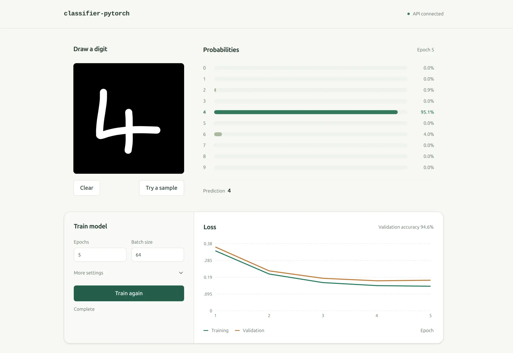

# Classifier PyTorch

A simple feed-forward neural network (FFNN) built with PyTorch to recognise handwritten digits, using MNIST's 60,000 training examples.



## Getting started

Find the latest stable pytorch versions [here](https://pytorch.org/get-started/locally/). The requirements use PyTorch's CUDA 13.2 build.

```bash
python3 -m venv .venv
source .venv/bin/activate

# Check CUDA Version
nvidia-smi

# Install dependencies and the local package
pip install -r requirements.txt

# Download the MNIST dataset
classifier data download

# View training examples
classifier data explore

# Predict one MNIST sample using random weights
classifier predict --random --sample 0

# Predict one MNIST sample using saved weights
classifier predict --load ./model.pt --sample 0

# Train a model and save its weights and settings
classifier train --epochs 5 --save ./model.pt

# Inspect checkpoint settings and tensors
classifier inspect ./model.pt
```

If you have [uv](https://docs.astral.sh/uv/getting-started/installation/), you can optionally replace the install command with `uv pip install -r requirements.txt`.

### Web interface

The optional frontend uses React, Vite, TypeScript and Tailwind. FastAPI serves an in-memory training session.

```bash
# Install dependencies
source .venv/bin/activate
pip install -r requirements.txt -e ".[web]"
npm --prefix frontend ci

# Start the API and frontend
./start.sh
```

If you have [uv](https://docs.astral.sh/uv/getting-started/installation/), you can optionally replace the install command with `uv pip install -r requirements.txt -e ".[web]"`.

## Model (FFNN)

```
┌─────────────────────┐
| 784 inputs (28x28)  |
└─────────────────────┘
       ↓ W1               (784 → 128)
┌─────────────────────┐
│ Linear (128 units)  │
│ ReLU activation     │
└─────────────────────┘
       ↓ W2               (128 → 10)
┌─────────────────────┐
│ Linear (10 units)   │
└─────────────────────┘
```

The 28×28 image is flattened into 784 input values and passed through the Feed-Forward Neural Network (FFNN) that contains an **input layer** (784 units), one **hidden layer** (128 units) with **ReLU** activation, and an **output layer** (10 units) that produces one score (logit) for each digit from 0 to 9.

Each linear layer performs a matrix multiplication and adds a bias. $W_1$ uses a 128x784 weight matrix to map 784 inputs to 128 hidden values; $W_2$ uses a 10x128 weight matrix to produce 10 logits.

## Training

Once the model has been initialised with random weights, we repeat the following steps:

1. Pass the images through the model to produce logits.
2. Calculate cross-entropy loss between the predicted distribution and the target distribution.
3. Backpropagate the loss to calculate the gradients for each weight and bias.
4. Use the optimizer (SGD) to step the weights and biases using these gradients and the learning rate.

After each epoch, evaluate the model by calculating the average loss on both the training and validation datasets to measure improvement.
